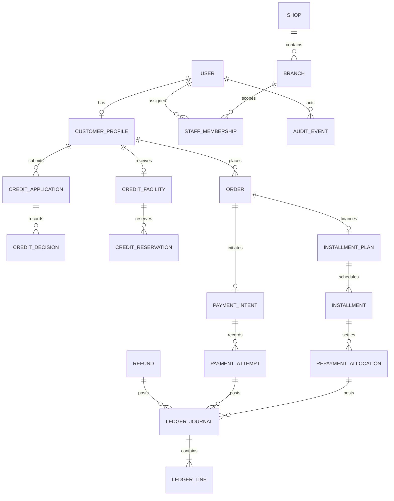

# Data model overview

PostgreSQL is authoritative. The diagram shows the first major relationships, not a complete schema. Detailed constraints and migrations are introduced with the owning domain phase.

## Core invariants

- Every monetary column is integer IRR, nonnegative where appropriate, and bounded by explicit checks.
- A posted journal has at least two lines and debits equal credits. Enforce posting in one database transaction; posted journals and lines are immutable. Correct them with linked reversals or adjustments.
- Credit availability is approved limit minus outstanding principal and live reservations, under a row lock or an atomic conditional update. It is never a wallet balance.
- An idempotency key is unique within a documented actor/operation scope. External callback IDs and provider references also have unique constraints.
- A reservation is created, consumed, expired, or released exactly once. State transitions use conditional updates and record an audit event.
- Installment schedules preserve their original agreement terms. Changes create explicit adjustments, not silent edits.
- Each staff membership carries a branch scope; every branch-owned query checks that scope on the server.
- Financial event references link a payment, order, refund, or repayment to its ledger posting and reconciliation record.

Use UUID identifiers for externally referenced records. Store timestamps in UTC; render Iranian-local time and Jalali dates at the presentation boundary. Keep customer-facing Toman formatting separate from the IRR ledger amount.
