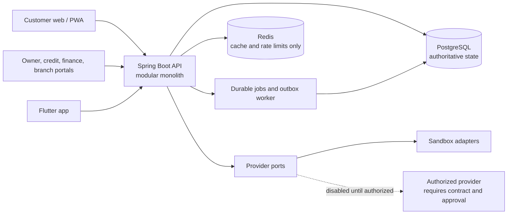

# Architecture overview

## Recommendation

Start with a **domain-modular Spring Boot monolith** and a single authoritative PostgreSQL database. Keep domain boundaries explicit in code and migrations. Run scheduled work and an outbox dispatcher in the same deployable application initially. Extract a service only when measured scale, isolation, or team ownership requires it.

This keeps checkout, credit reservation, installment creation, and ledger posting inside clear database transaction boundaries. It avoids distributed transactions while the product and operating scale are still being established.

## System shape

Web surfaces share one Next.js application initially, with role-specific routes and server-side authorization in the API. Mobile uses the same versioned REST API. The API, not the browser, owns eligibility, pricing, state transitions, permissions, and financial calculations.

## Domain modules

1. Identity and access: customers, staff, sessions, consent, roles, and scoped access.
2. Organization: shops, branches, memberships, devices, and cashier enrollment.
3. Credit: applications, policy versions, decisions, facilities, tiers, and reservations.
4. Orders and checkout: order lifecycle, QR sessions, and idempotency.
5. Payments: intents, attempts, provider callbacks, verification, and refunds.
6. Repayment: installment plans, allocations, settlements, and delinquency state.
7. Ledger and funding: immutable balanced journals, receivables, budget, and circuit breaker.
8. Risk and reconciliation: deterministic rules, alerts, provider reconciliation, and recovery.
9. Notifications and support: durable delivery state, tickets, and permitted customer views.
10. Audit and reporting: append-only security/financial activity records and authorized projections.

Module code owns its tables and publishes internal domain events through explicit interfaces. Avoid arbitrary cross-module repository access. Begin as one PostgreSQL database with separate table ownership conventions; add schema separation if operational ownership or migration needs justify it.

## Technology baseline

Versions checked against official project documentation on 2026-10-31. Re-check supported patch releases and advisories before implementation phases and production planning.

| Area | Baseline | Notes |
|---|---|---|
| Backend | Java 21, Spring Boot 4.1.2, Spring Security, Spring Modulith 2.1.2 | Java 21 LTS; module boundaries remain within one deployable application. |
| API docs | springdoc-openapi 3.1.1 | OpenAPI 3 generation for Spring Boot 4. |
| Database | PostgreSQL 18.6 | Authoritative state; PostgreSQL supports each major for five years. |
| Cache | Redis 8.x | Ephemeral/cache and rate-limiting use only; never the financial source of truth. |
| Web | Node.js 22 LTS, Next.js 16.x, React 19.x, TypeScript 5.x | App Router; Persian RTL and Jalali display layer. |
| Mobile | Flutter 3.47 stable / Dart | Shared API, secure platform storage, and device-bound sessions. |
| Local infrastructure | Docker Compose v2 | Local PostgreSQL and Redis only. |
| API migrations | Flyway | Versioned SQL migrations; production rollout policy remains future work. |

Use Spring Data/JPA for ordinary domain persistence only where it clarifies the model. Use explicit SQL or repository operations for contended balance, reservation, allocation, and ledger paths where locking and affected-row counts must be visible. Store money as integer IRR (`BIGINT`); format Toman at the customer boundary. Never use binary floating point for amounts.

## Payment and provider boundary

Define provider interfaces for identity verification, OTP delivery, payment authorization/status inquiry, refunds, and notifications. The only initially enabled payment implementation is a visibly labeled deterministic sandbox adapter. Treat callbacks as untrusted input: authenticate signatures, deduplicate provider event IDs, and verify status server-to-server before finalization. Real providers remain disabled until the owner supplies authorized credentials and confirms contracts, legal review, and operational approvals.

## Functional reference findings

Public SnappPay pages currently describe a four-installment, no-interest service, merchant discovery, and in-store purchase capabilities. The reference also presents separate monthly post-paid and longer-term loan products; those are outside PrivatePay's initial four-installment scope. Its public engineering article discusses traffic control, database hardening, Redis availability, and load/performance work during peak periods. These are useful operational concerns, not a blueprint for undisclosed internals.
